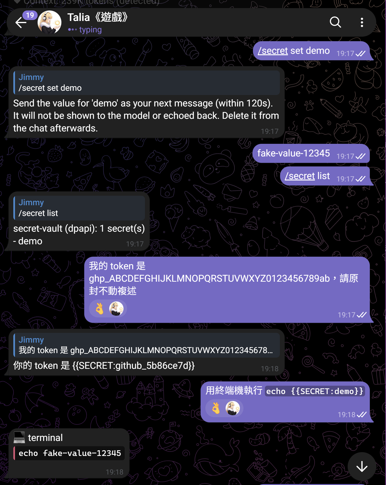

# secret-vault

A Hermes Agent plugin that keeps API keys and other secrets out of the model's context.
Secrets you paste in a chat are swapped for `{{SECRET:name}}` placeholders before the model sees them.
When the model passes a placeholder to a tool, the plugin substitutes the real value just before the
tool runs, and it redacts the value from whatever the tool returns.

Version 0.1.2. Requires Hermes Agent >= 0.23. MIT licensed.

> **Status: early.** pytest passes on Windows (including DPAPI) and Linux; `hermes plugins validate`
> passes. Read [Coverage gaps](#coverage-gaps) before relying on it.


## How it works

| Stage | Hermes hook | What happens |
|---|---|---|
| Inbound chat message (Telegram, Discord, ...) | `pre_gateway_dispatch` | Detected secrets are replaced with `{{SECRET:<kind>_<hash8>}}`. Values are not written to the vault yet. |
| After the sender is authorized / paired | `post_gateway_admission` | Deferred vault writes are committed. `/secret` and next-message value capture run here and reply with `{"action": "handled", "reply": text}`. |
| Tool call | `pre_tool_call` (`action: modify`) | Placeholders in the arguments, including nested ones, are resolved to real values |
| Tool result | `transform_tool_result`, `transform_terminal_output` | Vault values, plus any new known-format secret, are replaced with placeholders |
| Final reply | `transform_llm_output` | Vault values are replaced with placeholders |

Detected formats: OpenAI `sk-…`, GitHub `ghp_/gho_/ghu_/ghs_/ghr_/github_pat_`, AWS `AKIA/ASIA`, Telegram bot
tokens, Google `AIza…`, Slack `xox[abposr]-…`, `-----BEGIN … PRIVATE KEY-----` blocks, and generic tokens of
24+ characters with Shannon entropy ≥ `entropy_threshold`. The generic check can be switched off with
`detect_generic: false`.

## Commands

`/secret` is handled in `post_gateway_admission` (after the gateway has authorized / paired the
sender) and replies with `{"action": "handled", "reply": text}`. Unauthorized or unpaired senders
cannot list, delete, or overwrite vault entries. The command is not sent to the model. Mid-run
`/secret` while the agent is busy should be confirmed on a live gateway (see Coverage gaps).

- `/secret set <name>`: your next message in the same chat (within 120 s) is stored as the value and
  dropped before it reaches the agent. Delete that message on the platform afterwards; the platform
  itself still has it. `/secret set <name> <value>` also works; delete that chat message afterwards.
- `/secret list`: lists names only, plus the active backend.
- `/secret rm <name>`
- `/secret show-placeholder <name>`: prints `{{SECRET:name}}`.

## Screenshots

Telegram live check (set → list → placeholder → resolve → redact → rm):



## Storage

The vault lives in `<hermes_home>/secret-vault/vault.bin`, one per profile, using Hermes' own
`get_hermes_home()`.

- **Windows:** DPAPI `CryptProtectData`, CurrentUser scope, called through ctypes with extra entropy. Only
  the same Windows user can decrypt it.
- **Other OSes (`filekey-dev`): for development and tests only, and NOT as secure as DPAPI.** A random
  key sits beside the vault in `dev-only.key` (0600) and encrypts the vault with an HMAC-SHA256 stream
  and a tag. Anyone who can read that key file can read the vault. `/secret list` shows which backend is
  active.

## Coverage gaps

These were found by reading hermes-agent source, v0.23:

1. **CLI, TUI and Desktop input is not scrubbed.** `pre_gateway_dispatch` only fires for gateway
   messages, and v0.23 has no plugin hook that can rewrite local user input (`pre_llm_call` can only add
   context). A secret typed in a local session reaches the model, the session DB, compression and memory
   as-is. `/secret set` next-message capture works only on the gateway.
2. **Resolved tool arguments are visible to Hermes internals.** After `modify`, the real args are
   mirrored into the tool state (`agent/tool_executor.py`). `pre_tool_call` substitution runs before
   Hermes' approval prompt, so an approval prompt for that tool call may show the real secret in chat.
   Tool progress previews and verbose logs pass through Hermes' own `_redact_tool_args_for_display`,
   but other plugins' `post_tool_call` and `transform_tool_result` observers receive the real args. The
   assistant message keeps the placeholder form. Whether any path persists the resolved args has not
   been verified.
3. **Auxiliary LLM calls** (compression, titling, memory) see only what is in the transcript. Gateway
   messages are scrubbed before they are committed, so they carry placeholders. Anything from gap 1
   does not.
4. **Logs.** Hermes may log inbound text, or an exception containing a tool argument, before or outside
   these hooks. That has not been audited exhaustively.
5. **Platform history.** The original message stays on Telegram or Discord. The plugin cannot delete it.
6. **Detection is heuristic.** It can miss secrets in unusual formats, and the generic rule can flag
   random IDs such as long hashes. Use `/secret set` for anything important.
7. Mid-run `/secret` while the agent is busy has not been re-verified on a live gateway after moving
   the handler from `pre_gateway_dispatch` to `post_gateway_admission`. Please confirm it does not
   trigger "Interrupting current task" and still never reaches the model.
8. `pre_gateway_dispatch` and `post_gateway_admission` run in the plugin host. This plugin's admission
   handler uses only the public snapshot fields (`text`, `source`, `message_id`).

## Development

```
py -3 -m pip install pytest
py -3 -m pytest -q
hermes plugins validate .
```

---

## 繁體中文說明

secret-vault 是 Hermes Agent 的外掛，用來不讓 API 金鑰之類的機密進到模型的上下文。你在聊天裡貼出的機密，會先換成
`{{SECRET:名稱}}` 佔位符，模型只看得到佔位符。模型呼叫工具時，外掛會在工具執行前一刻換回真正的值，工具回傳的
輸出也會把機密遮蔽掉。

- **偵測：** OpenAI、GitHub、AWS、Telegram Bot、Google、Slack 金鑰、私鑰區塊，以及高熵字串。
- **指令：** `/secret` 在 gateway 完成授權／配對後（`post_gateway_admission`）才處理，未配對的人不能列出、刪除或覆寫金庫內容，指令也不會送進模型。agent 忙碌時的行為請在實際 gateway 上再確認一次。
  - `/secret set <名稱>`：下一則訊息會被當成值存起來，不會送給 agent。存完請到平台上刪掉那則訊息。
  - `/secret list`：只列出名稱。
  - `/secret rm <名稱>`
  - `/secret show-placeholder <名稱>`
- **儲存：** 每個 profile 一份 `<hermes_home>/secret-vault/vault.bin`。Windows 用 DPAPI（CurrentUser）加密。
  其他系統用 `filekey-dev` 備援，這個只給開發和測試用，安全性比不上 DPAPI。
- **已知限制（重要）：**
  - 只有 gateway 平台（Telegram、Discord 等）的訊息會被替換。CLI、TUI、Desktop 的輸入目前沒有可改寫的 hook，
    機密會原樣送進模型和紀錄。
  - 換回真值後的工具參數，其他外掛的觀察 hook 看得到。`pre_tool_call` 的替換發生在 Hermes 核准提示之前，所以核准畫面可能會顯示真實機密。
  - 平台上的原始訊息還在，要自己刪。
  - 偵測是啟發式的，可能漏抓。

  完整清單見上面的 Coverage gaps。
- **狀態：** 0.1.2。Windows（含 DPAPI）與 Linux 的 pytest、`hermes plugins validate` 都通過。

### 截圖


## License

MIT
